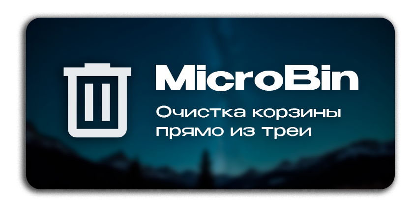

# MicroBin

[English documentation](README.en.md)



MicroBin — небольшое приложение для Windows, которое открывает и очищает корзину через системный трей.

## Возможности

- Открытие корзины в Проводнике.
- Очистка корзины на всех дисках.
- Настройка названия в трее и подписей пунктов меню.
- Пользовательская иконка в формате `.ico`.
- Настройка подтверждения очистки, окна прогресса и звука Windows.
- Сообщения об ошибках конфигурации и операций Windows.

## Запуск и настройка

Соберите приложение или скачайте артефакт `MicroBin-windows-x64` из успешного запуска GitHub Actions.
Распакуйте приложение в папку с правом записи и запустите `MicroBin.exe`.
При первом запуске приложение создаёт `config.toml` рядом с исполняемым файлом.

Измените `config.toml` и перезапустите MicroBin.
Также можно скопировать [config.example.toml](config.example.toml) под именем `config.toml`.
Пример включает подтверждение удаления и окно прогресса.

| Параметр | По умолчанию | Назначение |
| --- | --- | --- |
| `tray_label` | `"MicroBin"` | Подсказка иконки, не более 127 кодовых единиц UTF-16 |
| `open_label` | `"Open"` | Открыть корзину |
| `empty_label` | `"Empty"` | Очистить корзину |
| `quit_label` | `"Quit"` | Закрыть приложение |
| `icon_path` | `""` | Путь к `.ico`; пустая строка выбирает встроенную иконку |
| `confirm_empty` | `false` | Запросить подтверждение Windows перед очисткой |
| `show_progress` | `false` | Разрешить окно прогресса Windows |
| `play_sound` | `false` | Разрешить звук очистки Windows |

**Важно:** для совместимости стандартная конфигурация сохраняет очистку без подтверждения, прогресса и звука.
Удаление из корзины нельзя отменить через MicroBin. Установите `confirm_empty = true` для подтверждения.
Windows определяет отображение окна прогресса и воспроизведение звука.

Относительный путь иконки считается от папки `config.toml`, а не от текущей рабочей папки.
Используйте одинарные кавычки TOML для путей Windows: `icon_path = 'C:\Icons\bin.ico'`.
Иконка статическая: она не меняется при заполнении корзины.

Старые конфигурации с четырьмя подписями продолжают работать. Пропущенные параметры получают значения по умолчанию.
Неизвестные параметры, неверные типы, пустые подписи и слишком длинная подсказка вызывают сообщение об ошибке.
Приложение использует стандартную конфигурацию и не перезаписывает существующий файл.
Если загрузка иконки не удалась, приложение использует встроенную иконку.
Исправьте файл и перезапустите приложение.

Если приложение не может создать конфигурацию рядом с `.exe`, перенесите приложение в папку с правом записи.
Настройки не меняются автоматически при обновлении.

## Разработка

Для Windows нужны стабильный Rust с Cargo и средства сборки MSVC (Visual Studio Build Tools, компонент C++).

```powershell
cargo test --locked
cargo clippy --locked --all-targets -- -D warnings
cargo build --locked --release
```

Исполняемый файл: `target/release/MicroBin.exe`.

На Linux можно проверить конфигурацию без зависимостей графического окружения:

```sh
cargo fmt --all -- --check
cargo test --locked
cargo clippy --locked --all-targets -- -D warnings
```

Для кросс-сборки на Linux установите MinGW-w64 (GCC и windres) и цель Rust:

```sh
rustup target add x86_64-pc-windows-gnu
cargo build --locked --release --target x86_64-pc-windows-gnu
```

Кросс-сборка не проверяет работу трея. Проверьте меню, иконку, подтверждение, отмену и обработку ошибок на Windows.
CI запускает тесты на Linux и Windows и сохраняет сборку Windows как артефакт, но не проверяет интерфейс автоматически.
